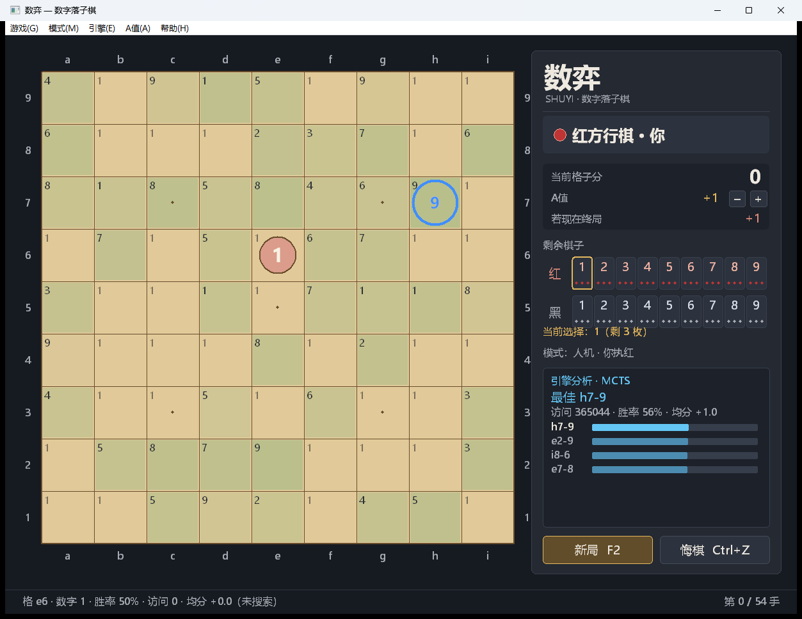

# 数弈（Shuyi）

9×9 的数字落子棋：两个独立程序、一条行协议、互不链接——**原生 Win32 界面**（管规则、状态、显示）
和**无头 NN-MCTS 引擎**（管搜索、网络、计算）。不依赖浏览器或任何 Web 运行时。
界面通过替换引擎程序就能换搜索，改 bug 时改动天然局限在一边。

训练侧是 C++/CUDA 自对弈 + PyTorch 训练器，产物是模型文件；产品和训练工具互不发布。



## 仓库里有什么

| 目录 | 是什么 | 单独构建 |
|---|---|---|
| [`core/`](core/) | 规则库：棋盘、着法合法性、计分、对称变换。两个产品**唯一**共享的东西 | `cmake -S core -B build-core` |
| [`engine/`](engine/) | `shuyi_engine.exe`：无头引擎，行协议服务（`random`/`pruning`/`mcts`/`mcts_nn`） | `cmake -S engine -B build-engine -DSHUYI_CUDA=ON` |
| [`ui/`](ui/) | `shuyi.exe`：Win32 界面，只管规则与调用，不含任何搜索 | `cmake -S ui -B build-ui` |
| [`protocol/`](protocol/) | 两个程序之间**唯一的契约**（协议 v2）＋一致性测试 | — |
| [`tools/`](tools/) | 开发工具：自对弈、锦标赛、证明检查、bench、探针。**不随任何发布** | `cmake -S tools -B build-tools` |
| [`training/`](training/) | Python 训练与评测流水线。**不随任何发布** | — |
| [`release/`](release/) | 打包脚本（`build_release.py`、`make_alpha.py`） | — |
| [`models/`](models/) | 发布用的权重：`b4c32-s34760`（v3）与 `b4c32-s42012`（v4），外加两个格式测试夹具。更强的 b6c96 权重产在 `runs/`，不入库 | — |
| [`data/`](data/) | 共享夹具：147 个终局分数见证（`score_witnesses.txt`） | — |
| [`runs/`](runs/) | 训练/评测输出，**不入库**——只有 [`runs/README.md`](runs/README.md)（命名与目录约定）跟着仓库走 | — |
| [`docs/`](docs/) | 规则、架构、评测方法、历次运行报告 | — |

## 维护者从哪开始

- [`docs/MAINTAINERS.zh-CN.md`](docs/MAINTAINERS.zh-CN.md)：文件地图——每个文件在哪、改它要注意什么；
- [`protocol/ENGINE_PROTOCOL.md`](protocol/ENGINE_PROTOCOL.md)：协议 v2（命令、流式 JSON、错误规则）；
- [`training/README.md`](training/README.md)：训练手册（原则、闸门、横评口径、改进记录）；
- [`docs/README.md`](docs/README.md)：文档索引；
- [`docs/plans/TRAINING_10H.zh-CN.md`](docs/plans/TRAINING_10H.zh-CN.md)：十小时训练的规模规则与实测结果。

## 现在的状态（2026-11-25）

| 项目 | 状态 |
|---|---|
| 规则 | 三套并行：`classic` 现行、`blocking` 阻挡、**`nopass` 无过手（默认）**。规则是运行时参数，数据、模型、界面全部隔离 |
| 引擎 | 四种搜索：`random` / `pruning`（α-β）/ `mcts` / `mcts_nn`；`shuyi_engine` 是持久化行协议进程，分析按毫秒间隔流式推送 |
| 主力模型 | **b6c96**（96 通道 × 6 残差块，1.03 M 参数，输入 37 平面 + 24 全局量，带分数头），nopass |
| 最强一版 | `b6c96-s87696-d937553`：128 visits 下 **+1804**（95% 区间 [+1745, +1879]），64 visits 下 +1718 |
| 仓库内模型 | 只有 `b4c32-s34760`（v3）与 `b4c32-s42012`（v4），都是阻挡规则训的；b6c96 那条链在 `runs/training/` 里，需要从服务器拉回 |
| 评测 | 预算按 **visits**，`training/evalconfig.py` 的 `EVAL_VISITS = 512` 是唯一定义；排行榜按 64/128/256/512 分开算，**从不混算** |
| A值 | 是运行时参数：nopass **+0.5**、阻挡 +1.26、现行 −0.5（标定方法见 [`docs/A_VALUE_ANALYSIS.zh-CN.md`](docs/A_VALUE_ANALYSIS.zh-CN.md)） |

## 快速开始

```bash
# 开发者一把梭：core + 引擎 + 界面（Windows）+ 测试；工具默认不编
cmake -S . -B build -G Ninja -DCMAKE_BUILD_TYPE=Release
cmake --build build -j 8
ctest --test-dir build --output-on-failure          # Windows 上 11 个；Linux 构建不含界面测试

# 开界面（Windows）：同目录有 shuyi_engine.exe 就会自动加载，空格开始/停止分析
build/shuyi.exe

# 直接驱动引擎（行协议；命令可带 id，分析流式返回 JSON）
printf 'ruleset nopass\nset_model models/b4c32-s42012-d595499.bin\nset_engine mcts_nn\nset_visits 512\n1 analyze red 512 interval 100\n' | build/shuyi_engine
```

CUDA 引擎：`cmake -S . -B build-cuda -DSHUYI_CUDA=ON -DCUDAToolkit_ROOT=<cuda>`。
Windows 上 nvcc 不接受中文路径，仓库里用 junction 绕开：`cmake -S C:/shuyi_src -B C:/shuyi_cuda_build ...`。

打包（跑测试 → 两个二进制 + 文档 + 可选模型 → `dist/`）：

```bash
python release/build_release.py --cuda-build build-cuda \
    --model models/b4c32-s42012-d595499.bin
```

## 规则一句话

红先，双方轮流在空格放下数字 1–9 的棋子，每种数字各三枚。54 枚落完后，按"每格十字上红黑
最大数字的符号"逐格计分，加上 A值：为正红胜、为负黑胜、为零和棋。

三套规则共享计分，只在落子限制和终局时机上不同：

| 规则集 | 落子限制 | 无子可落时 |
|---|---|---|
| `classic` 现行 | 任意空格 | 不存在（54 手才终局） |
| `blocking` 阻挡 | 四邻有异色且数字 ≥ n 则该着非法 | 强制过手，连续两次过手终局 |
| **`nopass` 无过手（默认）** | 同上 | **立刻终局计分** |

无过手没有"过手"这个回合：一方无子可落，棋局当场结束，每个回合都是落子，"把对手困死"
成为真正的终局手段。完整定义见 [`docs/RULES.zh-CN.md`](docs/RULES.zh-CN.md)。

## 强度与评测

`training/leaderboard.py` 从 `runs/leaderboard/matches_<visits>.csv` 拟合并给出区间，
**random 锚定 0**，95% 区间是 200 次 bootstrap：

| 参赛者 | 128 visits | 64 visits |
|---|---:|---:|
| `b6c96-s87696-d937553` | **+1804** [+1745, +1879] | **+1718** [+1671, +1776] |
| `b6c96-s76464-d824361` | +1763 [+1712, +1825] | +1672 [+1626, +1728] |
| `b4c32-s42012-d595499` | +1606 [+1561, +1647] | +1504 [+1467, +1538] |
| `random` | 0 | 0 |

读法：b6c96 这条链从 2026-11-24 起跑，25 日那十小时又加了 6 代（`s31536` → `s87696`），
每代对上一代 54–60%；128 visits 下顶层与底层差 1,800 分。相对池子来说，b4c32 的 v4
（`b4c32-s42012`，仓库里带的那一版）仍在 1,600 附近，b6c96 已经把它甩开两百。
按预算分表的完整数据在 `runs/leaderboard/leaderboard.md`（本地产物，不入库）与
[`docs/ELO_METHODOLOGY.zh-CN.md`](docs/ELO_METHODOLOGY.zh-CN.md)。

## 训练怎么跑

```bash
# 一条命令：探测这台卡的速率 → 按窗口定代数/局数/步数 → 逐代自对弈、过闸门、训练、竞技场
HOURS=8 MODEL=models/b6c96-s87696-d937553.bin RUN_NAME=b6c96-nopass-20261126a \
    bash training/run_session.sh
```

规则写在代码里（[`training/budget.py`](training/budget.py)），不靠记忆：

- **每代局数 2,000–4,000，窗口尽量多分代**——代数才是学习发生的单位；不足 2,000 局就报错，不缩水；
- 每代目标梯度步数随参数放大：`10,000 × (M / 1.03)`；训练集按回放窗口 2 代 ×1.8 计时间；
- `--max-hours` 在代与代之间检查，剩下不够跑完下一代就停，绝不半途断电。

自对弈是 C++ 树 + CUDA 批量前向（[`tools/selfplay/selfplay_gpu.cpp`](tools/selfplay/selfplay_gpu.cpp)），
3080 上实测 **0.84 局/s**（1024 visits、batch 32、3 个并发对局组），训练约 **3.6 万样本/s**。
细节、闸门与历次改进记录在 [`training/README.md`](training/README.md)。

## 三条硬规则

1. **棋力只认 Elo**，不看 val loss。自对弈的验证损失在第几个 epoch 就到底然后上漂——那是
   目标的噪声地板，不是收敛信号；停滞之后的步数是在把当代目标蒸馏进权重，恰恰是让下一代
   变强的动作（实测见 [`docs/plans/TRAINING_10H.zh-CN.md`](docs/plans/TRAINING_10H.zh-CN.md) §1.1）。
2. **Elo 永远以 `random = 0` 为基准**；强弱用相对 Elo + 置信区间表达，不用"胜率"讲故事。
3. **评测预算按 visits**，`training/evalconfig.py` 是唯一来源，同一张表里不许混预算，
   也不许用时间预算；`elo.py` 会拒绝合并不同预算的矩阵。

## 模型命名

`b{blocks}c{channels}-s{steps}-d{data}`：步数 = 累计优化步，数据 = 累计训练局面数。
规则不写进文件名，它是模型头里的一个字节；run 目录名（`runs/training/b6c96-nopass-20261125a`）
才带规则。约定写在 [`runs/README.md`](runs/README.md)，`pipeline.py` 照它落盘。

## 已知限制（按影响排序）

1. **数据量仍是初期**：b6c96 这条链累计约 94 万局面（`d937553`），八小时一轮再追加约 100 万。
   对 100 万参数的网来说这还只是一个开头，模型容量已经不是瓶颈（b6c96 与 KataGo 最小档同量级），
   数据是。
2. **强模型不在仓库里**：`models/` 只有 b4c32 那两个（外加两个格式夹具）。b6c96 的权重产在
   `runs/training/`，要用就先从服务器拉回（[`training/pull.py`](training/pull.py)）。
3. **A 的训练分布很窄**：自对弈只在锚点 A 下进行，训练时 35% 样本固定在锚点、65% 抽 ±4；
   |A| 更大时的读数只能算外推。
4. **分数头只有 b6c96 有**：`models/` 里的 b4c32 都没有分数头（`flags bit0 = 0`），
   界面第三行显示 `--`——**刻意**不显示用胜率线性映射猜出来的假分数。
5. **CPU 版 MCTS-NN 慢**：同样的模型在 CPU 上前向是毫秒级，只适合调试，不适合对局。

## 实现要点

- 坐标内部 `x,y = 0..8`，`a1` 在左下；81 位 bitboard 用两个 64 位字；Zobrist 含行棋方。
- α-β：迭代加深 + aspiration window + PVS + 置换表，预算按**节点数**，不看墙钟。
- MCTS：SoA 节点/边、PUCT、根/内部宽度上限；同一局面的树会被后续 `analyze` 复用。
- **终局是求解，不是估值**：剩余 6 手以内进精确解算（便宜路径 25 万节点），7 手在搜索后
  再解一次（200 万节点），8 手只证明搜索喜欢的少数着法（自适应预算，总花费封顶 150 万节点）。
  已证明的节点**不再当叶子展开**，后续访问直接返回精确值；目差只在精确时公布，没证明就
  显示 `--`，绝不把"已证明子集里的最大值"当成目差。
- 网络：ResNet（残差 + 策略头 + 价值头 + 可选分数头），CPU 与 CUDA（im2col + cuBLAS）双后端，
  `--check` 逐位对拍；自对弈用多个 CUDA 流并发吃满卡。
- 界面：分析标记与棋子同形；最优格按**置信下界**（Wilson）排序而不是裸胜率，所以不会在低访问
  的格子上乱跳；已解算的格子例外，按精确胜率（同胜负再比精确目差）。预算优先用 visits——
  只有引擎在 `capabilities` 里报告不支持 visit 预算时，界面才退回毫秒预算。

## 许可

MIT，见 [LICENSE](LICENSE)。
