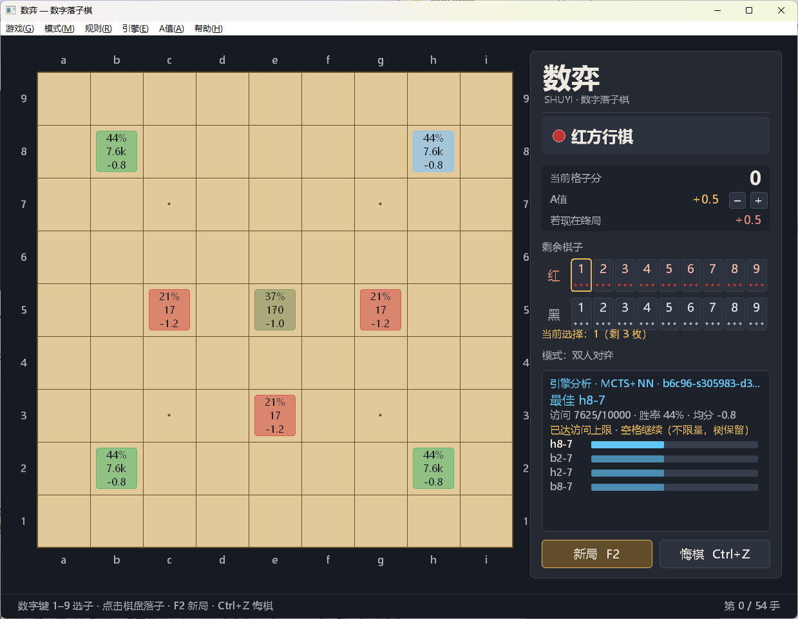

# 数弈（Shuyi）

游戏数弈的实现，以及 AlphaZero 类引擎的实现，游戏不是本人设计。

视频介绍：[必然激烈的抽象棋——数弈](https://www.bilibili.com/video/BV1UEsW6yEyi)

对弈网站：[https://numerith.online/](https://numerith.online/)

**很可能是目前世界上最强大的数弈引擎。**

本项目文档和代码大多为ai写作，有些地方表述错误或者落后与版本。

本项目包含：**原生 Win32 界面**
和**无头 NN-MCTS 引擎**，和训练代码。

训练侧是 C++/CUDA 自对弈 + PyTorch 训练器。

目前模型文件没有统一发布通道，因为模型文件会让 clone/push 变得缓慢，目前只会在 release 时发布当时的最强模型。



## Windows用户使用

去
[**Releases**](https://github.com/zhou-tian-xing/shuyi/releases/) 下载适合于自己设备的压缩包。

包内有编译产物和当时最强的权重。

解压 → 双击 `shuyi.exe` → 按空格让引擎分析，或直接落子。

如果有其他渠道下载模型，你可以把模型放在目录下，可以自动识别。

> CPU 包不需要任何额外组件。CUDA 包额外需要 CUDA 12 运行时
> （`cudart64_12.dll`、`cublas64_12.dll`、`cublasLt64_12.dll`，装 CUDA Toolkit 12.x 即可）。

只要引擎（自己写前端、批量跑对局）：同一页面下的 engine 包，
里面只有 `shuyi_engine.exe` 和协议文档。

---

开发者还需要继续阅读如下部分。

## 仓库里有什么

| 目录 | 内容 |
|---|---|
| `core/` | 规则：棋盘、合法性、计分、对称变换。界面与引擎唯一共享的代码 |
| `engine/` | `shuyi_engine`：无头引擎，行协议（`random` / `pruning` / `mcts` / `mcts_nn`） |
| `ui/` | `shuyi.exe`：Win32 界面，不含搜索 |
| `protocol/` | 协议 v2 与一致性测试 |
| `tools/` | 自对弈、锦标赛、证明检查、bench 等开发工具 |
| `training/` | Python 训练与评测流水线 |
| `release/` | 打包与发布脚本 |
| `models/` | 少量随仓库的权重与格式夹具；完整权重见下文"权重" |
| `data/` | 终局分数见证等测试夹具 |
| `docs/` | 规则、架构、评测方法、运行报告 |

每个子目录都能单独构建，例如 `cmake -S engine -B build-engine -DSHUYI_CUDA=ON`。

## 构建

```bash
cmake -S . -B build -G Ninja -DCMAKE_BUILD_TYPE=Release
cmake --build build -j 8
ctest --test-dir build --output-on-failure
```

CUDA 引擎加 `-DSHUYI_CUDA=ON`；Windows 上 nvcc 要求源码路径为 ASCII：

```bat
cmake -S C:/shuyi_src -B C:/shuyi_cuda_build -G Ninja -DCMAKE_BUILD_TYPE=Release -DSHUYI_CUDA=ON -DSHUYI_BUILD_UI=ON
cmake --build C:/shuyi_cuda_build --config Release
```

出安装包（四个包 + 源码包）：

```bash
python release/build_1_0.py --model <某个 .bin>
```

## 规则

红先，双方轮流在空格放下数字 1–9 的棋子，每种数字各三枚。54 枚落完后按"每格十字上红黑最大数字的符号"
逐格计分，加上 A 值：正则红胜、负则黑胜、零则和棋。三套规则共享计分，只在落子限制和终局时机上不同：

| 规则集 | 落子限制 | 无子可落时 |
|---|---|---|
| `classic` | 任意空格 | 不存在（54 手终局） |
| `blocking` | 四邻有异色且数字 ≥ n 则非法 | 强制过手，连续两次终局 |
| `nopass`（默认） | 同上 | 立刻终局计分 |

A 值默认 nopass +0.5、blocking +1.26、classic −0.5，可在界面设置或 `shuyi-ui.ini` 里改。
全文见 [`docs/RULES.zh-CN.md`](docs/RULES.zh-CN.md)。

## 权重

权重不随仓库发布。获取方式只有两处：

- 安装包里带一份当时最强的权重；
- [Releases](https://github.com/zhou-tian-xing/shuyi/releases) 的资产里有历史权重和单独的最强模型。

把任意 `b<blocks>c<channels>-s<steps>-d<data>.bin` 放进 `models/`（或安装包同目录），界面菜单会自动列出；
规则集写在模型头里，不在文件名里。

## 评测

[`training/leaderboard.py`](training/leaderboard.py) 从 `runs/leaderboard/matches_<visits>.csv` 拟合 Elo，
锚点 `random = 0`，按 visits 分表、不混预算。榜单写到 `runs/leaderboard/leaderboard.md`。
口径见 [`docs/ELO_METHODOLOGY.zh-CN.md`](docs/ELO_METHODOLOGY.zh-CN.md)，历次结果见 [`docs/reports/`](docs/reports/)。

## 训练

```bash
HOURS=8 MODEL=<起始 .bin> RUN_NAME=<名字> bash training/run_session.sh
```

每代局数与步数由 [`training/budget.py`](training/budget.py) 按实测速率确定；
自对弈是 C++ 树 + CUDA 批量前向。细节见 [`training/README.md`](training/README.md)。

## 文档

- [`docs/MAINTAINERS.zh-CN.md`](docs/MAINTAINERS.zh-CN.md)：文件地图
- [`protocol/ENGINE_PROTOCOL.md`](protocol/ENGINE_PROTOCOL.md)：协议 v2
- [`training/README.md`](training/README.md)：训练手册
- [`docs/README.md`](docs/README.md)：文档索引
- [`docs/reports/`](docs/reports/)：历次运行报告

## 实现要点

- 坐标 `x,y = 0..8`，`a1` 在左下；81 位 bitboard 用两个 64 位字；Zobrist 含行棋方。
- α-β：迭代加深 + aspiration window + PVS + 置换表，预算按节点数。
- MCTS：SoA 节点与边、PUCT、根与内部宽度上限；同一局面的树可被后续 `analyze` 复用。
- 终局按求解处理：剩余 6 手以内精确解算，7 手在搜索后再解一次，8 手只证明少数着法；已证明节点不再展开。
- 网络：ResNet（策略头 + 价值头 + 可选分数头），CPU 与 CUDA（im2col + cuBLAS）双后端，`--check` 逐位对拍。
- 界面：最优格按 Wilson 置信下界排序；已解算的格子按精确值并显示目差。

## 已知限制

- `b4c32` 系列没有分数头，界面第三行显示 `--`。
- A 的训练分布集中在锚点附近，|A| 较大的读数是外推。
- CPU 版 MCTS-NN 前向是毫秒级，只适合调试。

## 许可

MIT，见 [LICENSE](LICENSE)。
